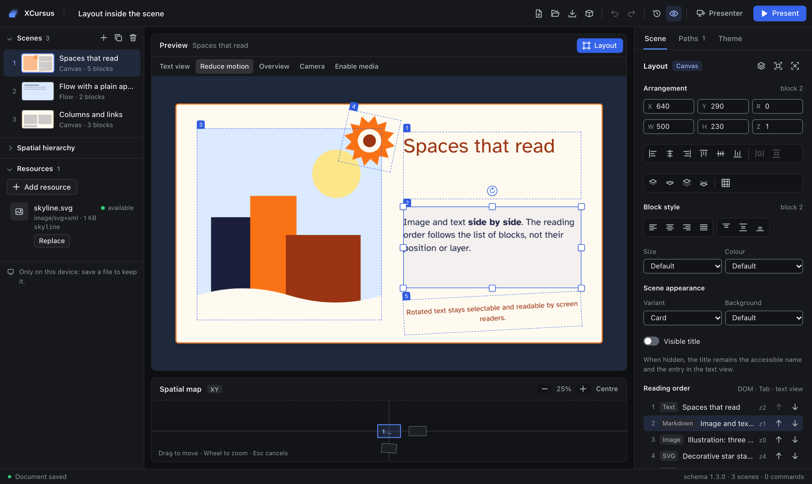

<p align="center">
  <picture>
    <source media="(prefers-color-scheme: dark)" srcset="docs/assets/logo-dark.svg">
    
  </picture>
</p>

<p align="center">
  <b>Spatial, non-linear presentations for the web.</b><br>
  Place scenes in 3D space, branch the story, present offline. No account, no backend, no lock-in.
</p>

<p align="center">
  <a href="https://github.com/XCursus/xcursus/actions/workflows/ci.yml"></a>
  <a href="LICENSE"></a>
  
  
</p>

<p align="center">
  <a href="docs/AUTHORING.md">Studio guide</a> ·
  <a href="docs/FILE_FORMAT.md">File format</a> ·
  <a href="docs/DISTRIBUTION.md">CLI &amp; export</a> ·
  <a href="docs/API.md">API</a> ·
  <a href="docs/ROADMAP.md">Roadmap</a>
</p>

<p align="center">
  
</p>

## What XCursus is

XCursus is a local-first platform for presentations that live in space rather than on a stack of slides. Scenes are rectangles you position, rotate, scale and nest in a 3D world; a camera flies between them along the paths you design, including branches, choices and limited loops. One JSON document drives both a **framework-free player** you can embed in any web page and **XCursus Studio**, a visual editor that runs entirely in the browser.

## What it solves

- **Non-linear talks.** A presentation is a graph, not a list: the audience can take a branch, and going back follows the path actually taken.
- **Spatial storytelling.** Overviews, zooms into detail and nested scenes are first-class, with a precise, documented geometry.
- **Ownership and longevity.** Projects are plain, versioned JSON or a single portable `.xcursus` file; nothing depends on a service, an account or a network connection.
- **Safe sharing.** Decks are data: no code is ever loaded from a document, user markup is sanitized, and exports run under a strict Content Security Policy.
- **One rendering everywhere.** The editor preview, the live presentation, the presenter's audience window and every export use the same player, so what you author is what is shown.

## Features

- 🌌 **[Scenes in space](docs/AUTHORING.md#scenes-and-space)**: position, rotate and scale scenes in CSS 3D, nest them up to 32 levels deep and reparent them without moving them in the world.
- 🔀 **[Non-linear paths](docs/AUTHORING.md#hierarchy-paths-and-camera)**: branches with labelled choices, limited loops, several itineraries per project.
- 🎥 **[Camera tracks](docs/AUTHORING.md#hierarchy-paths-and-camera)**: independent camera poses and keyframed tracks (linear or Catmull-Rom) with declarative cues for the host page.
- 🧱 **[Eleven block types](docs/AUTHORING.md#blocks-and-resources)**: text, Markdown, HTML, SVG, LaTeX (KaTeX), image, audio, video with captions, internal links, opt-in embeds and plugins.
- 📐 **[Canvas layout](docs/AUTHORING.md#layout)**: side-by-side, overlapping and rotated blocks with snapping, alignment and layers, a document theme and style tokens; never free CSS.
- 🎙️ **[Presenter view](docs/AUTHORING.md#presenter-export-and-offline-use)**: an audience window kept in sync with a console that shows private notes, the next scene or the branch choices, and a timer.
- 📦 **[Exports](docs/DISTRIBUTION.md)**: a single offline HTML file that opens from `file://`, with on-screen and touch navigation, a static web build, a PDF with one page per visit and a deterministic WebM video.
- 🧭 **[impress.js import](docs/IMPRESS.md)**: convert an impress.js presentation into a reviewed XCursus project, geometry checked against the upstream engine; nothing in the HTML runs.
- ✈️ **Local-first and offline**: Studio installs as an offline app, autosaves to the browser with recovery, and saves plain JSON or a portable [`.xcursus`](docs/FILE_FORMAT.md) archive.
- ♿ **[Accessible by design](docs/SPECIFICATION.md#10-security-and-accessibility)**: keyboard navigation, a linear text view, reduced motion, a reading order independent of visual layering, and axe audits in CI.
- 🔒 **[Safe with untrusted decks](docs/PLUGINS.md#trust-model-and-threats)**: one sanitization pipeline, no `eval`, no code loaded from documents, a validated JSON Schema with migrations from every earlier version.

## Components

| Component                                                      | What it is                                                                                                                                       |
| -------------------------------------------------------------- | ------------------------------------------------------------------------------------------------------------------------------------------------ |
| [XCursus Studio](apps/studio)                                  | The visual editor: scenes, map, inspector, layout editor, paths and camera timeline, presenter console, HTML export, offline shell.              |
| [`@xcursus/core`](packages/core/README.md)                     | The document model: JSON Schemas 1.0.0–1.3.0, validation with JSON Pointer diagnostics, migrations, camera and layout math, navigation, capture. |
| [`@xcursus/player`](packages/player/README.md)                 | The framework-free DOM/CSS 3D player, with a presenter protocol and a classic script build.                                                      |
| [`@xcursus/plugins`](packages/plugins/README.md)               | Builtin renderers, the sanitization pipeline, the `.xcursus` archive and the plugin SDK.                                                         |
| [`@xcursus/editor`](packages/editor/README.md)                 | The React editor behind Studio: command store with undo/redo and IndexedDB recovery.                                                             |
| [`@xcursus/cli`](packages/cli/README.md)                       | The `xcursus` command: validate, pack, build and export HTML, PDF and video; convert impress.js presentations.                                   |
| [`@xcursus/impress-compat`](packages/impress-compat/README.md) | The impress.js importer: inert parsing, exact geometry, diagnostics for what is not carried over.                                                |
| [Playground](apps/playground)                                  | Vanilla pages that exercise the player at `/core`, `/structure`, `/content` and `/layout`.                                                       |

## Install and run

You need **Node 24.22.0** and **pnpm 12.14.0** ([local installation without changing your global tools](docs/DEVELOPMENT.md#toolchain-and-installation)).

```sh
git clone https://github.com/XCursus/xcursus.git
cd xcursus
pnpm install --frozen-lockfile
pnpm dev:studio
```

Open <http://127.0.0.1:5174>. `pnpm dev:playground` serves the vanilla player pages.

## Create a project

1. In Studio, choose **Create the first scene**, or **Open** an example such as [`examples/layout-canvas/layout-canvas.xcursus`](examples/layout-canvas/layout-canvas.xcursus).
2. Add scenes, place them on the map and in the inspector, add blocks and resources, and connect visits in the **Paths** tab. The [Studio guide](docs/AUTHORING.md) walks through every panel.
3. **Save archive** writes a portable `.xcursus` file with every asset; **Save JSON** writes the document alone. Archives saved with SpatialDeck, the former name of XCursus, open as well (`.spatialdeck`) and are saved again as `.xcursus`.
4. **Present** plays the project full screen; **Presenter** opens the audience window and the speaker console.

## Distribute it

Build the CLI once, then export from the `.xcursus` file or from the JSON with its assets:

```sh
pnpm build
pnpm xcursus export html  deck.xcursus --out deck.html
pnpm xcursus build        deck.xcursus --out site
pnpm xcursus export pdf   deck.xcursus --itinerary itinerary.json --out deck.pdf
pnpm xcursus export video deck.xcursus --itinerary itinerary.json --fps 30 --out deck.webm
pnpm xcursus convert impress slides.html --out deck.json   # from impress.js, with a report
```

Every output is rendered by the same player and comes with a manifest that lists resources, licences, warnings and the checks actually run. Exports are strict by default and private notes never leave the authoring project. PDF and video need Chromium for Playwright; video also needs `ffmpeg` and `ffprobe`. `pnpm xcursus pack` converts a JSON project or a legacy archive to `.xcursus`. Details: [CLI, export and presentation](docs/DISTRIBUTION.md).

To embed the player in your own page:

```ts
import { createPlayer } from "@xcursus/player";
import "@xcursus/player/style.css";
import project from "./project.json";

const player = createPlayer({ input: true });
const mounted = await player.mount(document.querySelector("#deck")!, project);
if (mounted.ok) await player.next();
```

> [!NOTE]
> Install from npm: `npm install @xcursus/core @xcursus/player` for the player, `@xcursus/plugins` for the rich renderers and archives, `@xcursus/editor` to embed Studio, and `npm install --global @xcursus/cli` for the `xcursus` command. The published version is 0.6.0; the 1.0 candidate described here, with `@xcursus/impress-compat`, is in this repository and not published yet.

## Documentation

| Topic                                       | Document                                                       |
| ------------------------------------------- | -------------------------------------------------------------- |
| Using XCursus Studio                        | [docs/AUTHORING.md](docs/AUTHORING.md)                         |
| Project files and `.xcursus`, legacy import | [docs/FILE_FORMAT.md](docs/FILE_FORMAT.md)                     |
| CLI, export and presentation                | [docs/DISTRIBUTION.md](docs/DISTRIBUTION.md)                   |
| API and integration                         | [docs/API.md](docs/API.md)                                     |
| Renderers, plugins and trust model          | [docs/PLUGINS.md](docs/PLUGINS.md)                             |
| Architecture and design decisions           | [docs/ARCHITECTURE.md](docs/ARCHITECTURE.md)                   |
| Specification                               | [docs/SPECIFICATION.md](docs/SPECIFICATION.md)                 |
| Development and contributing                | [docs/DEVELOPMENT.md](docs/DEVELOPMENT.md)                     |
| Testing and verification                    | [docs/VERIFICATION.md](docs/VERIFICATION.md)                   |
| Importing impress.js presentations          | [docs/IMPRESS.md](docs/IMPRESS.md)                             |
| Roadmap and known issues                    | [docs/ROADMAP.md](docs/ROADMAP.md)                             |
| What blocks 1.0                             | [docs/RELEASE_BLOCKERS.md](docs/RELEASE_BLOCKERS.md)           |
| Changes by release                          | [CHANGELOG.md](CHANGELOG.md)                                   |
| Contributing and reporting vulnerabilities  | [CONTRIBUTING.md](CONTRIBUTING.md), [SECURITY.md](SECURITY.md) |

## Examples

| Example                                                               | Shows                                                              |
| --------------------------------------------------------------------- | ------------------------------------------------------------------ |
| [`core-three-scenes`](examples/core-three-scenes/project.json)        | Three scenes in different places, the minimal document             |
| [`structure-branching`](examples/structure-branching/project.json)    | Branches, a rotated child scene, a limited loop and a camera track |
| [`content-gallery`](examples/content-gallery/content-gallery.xcursus) | All eleven block types with local media                            |
| [`layout-canvas`](examples/layout-canvas/layout-canvas.xcursus)       | Canvas layout, theme, hidden title and reading order               |
| [`distribution-static`](examples/distribution-static/project.json)    | The export fixture, with itineraries for PDF and video             |
| [`impress-import`](examples/impress-import/deck.html)                 | An impress.js presentation to convert, with local images           |

## Status

XCursus is a **1.0 candidate**, still a pre-release: the 1.0 Stabilization work (impress.js import, hardening, budgets, project documents) is done and tested on Chromium, Firefox and WebKit and on an installed Google Chrome, but 1.0 is not declared until the open [release blockers](docs/RELEASE_BLOCKERS.md) are closed, real Safari and Edge, touch devices, a screen reader and a benchmark on a controlled machine. See the [roadmap](docs/ROADMAP.md) and [VERIFICATION](docs/VERIFICATION.md) for what is tested and how.

## Licence

[GPL-3.0-or-later](LICENSE), for every package including the embeddable player. Artefacts that bundle third-party code (the player IIFE, the export runtime, standalone HTML) ship with generated licence notices. Example media are original and dedicated to the public domain (CC0-1.0); the bundled Atkinson Hyperlegible font is under the SIL Open Font License 1.1. The impress.js files used as test fixtures (`packages/impress-compat/test/fixtures/upstream`) are unmodified MIT-licensed copies with their licence and provenance; they are never part of a package or a build.
