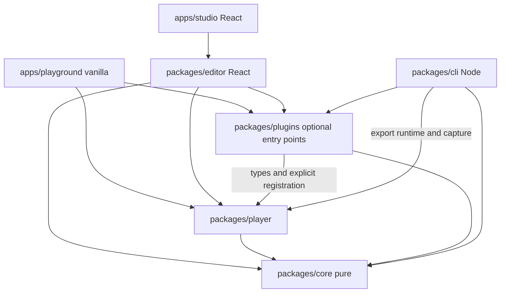

# Architecture

XCursus is a TypeScript monorepo. A framework-free core and player do all the document, geometry and rendering work; XCursus Studio, the command line and every export reuse them instead of reimplementing them. This document describes the structure, the boundaries that keep it that way and the technical decisions behind the less obvious parts. The normative behaviour is in the [specification](SPECIFICATION.md); the programmatic surface is in [API](API.md).

## Principles

- **Local-first.** Authoring, presenting and exporting need no account, backend or remote service. Network access is needed only to install dependencies and test browsers.
- **One document, one player.** Studio's preview, the presentation, the presenter's audience window, the embeddable player, the standalone HTML, the static build, the PDF and the video are all rendered by the same DOM/CSS 3D player. The Studio map is an authoring tool, not a second renderer.
- **Pure core.** Validation, migration, geometry, navigation, layout and capture math live in `@xcursus/core`, which has no DOM, React, file system or network dependency.
- **Data, never code.** A document is untrusted JSON. Nothing in it is executed: no scripts, expressions, remote modules or CSS strings. User markup goes through a single sanitization pipeline; plugins are code approved by the host application, not by the document.
- **Explicit versions.** The document schema, the archive manifest and the plugin API are versioned independently of the product; every schema change comes with a migration.

Separation of concerns inside a document:

| Dimension    | Holds                                                        | Never holds                             |
| ------------ | ------------------------------------------------------------ | --------------------------------------- |
| Content      | Ordered blocks, assets, alternative text, media              | Selection state or camera coordinates   |
| Space        | Scenes, sizes, transforms and parents                        | Visit order                             |
| Path         | Nodes, connections, choices; history exists only at run time | A camera constraint equal to the target |
| Time         | Durations, easing, keyframes, declarative cues               | JavaScript                              |
| Presentation | Run-time camera, input, audience and presenter state         | Persistent editor state                 |

## Repository layout

| Path                    | Contents                                                                                                                                    |
| ----------------------- | ------------------------------------------------------------------------------------------------------------------------------------------- |
| `packages/core`         | `@xcursus/core`: JSON Schemas (`schema/`), generated types and validators, semantics, migrations, math, layout, navigation, timing, capture |
| `packages/player`       | `@xcursus/player`: DOM/CSS 3D player, input, accessibility, renderer registry, asset resolver, messages, presenter protocol, IIFE build     |
| `packages/plugins`      | `@xcursus/plugins`: plugin SDK, rich/media/navigation renderers, sanitization (`security.ts`), the `.xcursus` archive, the demo badge       |
| `packages/editor`       | `@xcursus/editor`: React components of Studio, command store, commands, IndexedDB storage                                                   |
| `packages/cli`          | `@xcursus/cli`: the `xcursus` command, confined file IO, export profiles, page assembly, Chromium and FFmpeg capture, export runtime        |
| `apps/studio`           | XCursus Studio: Vite + React app, audience window (`present.html`), offline shell                                                           |
| `apps/playground`       | Vanilla pages that exercise the player: `/core`, `/structure`, `/content`, `/layout`                                                        |
| `examples`              | Example and fixture decks with their assets (CC0 where original)                                                                            |
| `tests/e2e`             | Playwright suites in Chromium, Firefox and WebKit                                                                                           |
| `tests/fixtures/legacy` | Files written by earlier releases, kept to test backward compatibility                                                                      |
| `scripts`               | Code generation, boundary and bundle checks, packaging helpers, E2E launcher                                                                |
| `tools/webkit-macos14`  | Private workspace pinning the Playwright version able to drive WebKit on macOS 14                                                           |

## Package dependencies

Arrows denote dependency. The player exposes interfaces for renderers and never imports `plugins` or `editor`; `core` imports no DOM, React, file system, network, player or plugin; optional renderers never enter the default bundle. `pnpm check:boundaries` enforces these rules on the sources and on the built output (no React, editor, `eval` or `new Function` in core, player, IIFE or export runtime), and `pnpm check:bundle` measures the minimal core+player consumer against its budget.

React and React DOM are peer dependencies of the editor only. Third-party libraries stay external dependencies of the packages: a build plugin fails if a library chunk contains a module from `node_modules`, so consumers can update DOMPurify, marked, KaTeX, fflate, gl-matrix and the Ajv runtime in their own lockfile.

## Document pipeline

1. **Schema to code.** `pnpm generate` (`scripts/generate.mjs`) compiles the four JSON Schemas into standalone Ajv validators (`packages/core/src/document/validator.js`) and derives the TypeScript types (`types.ts`) from the current schema. Both files are generated and never edited by hand. Validators are compiled at build time so the player respects a CSP without `unsafe-eval` and does not ship the Ajv compiler; `inlineRefs: false` avoids duplicating the `frame` and `style` definitions for each block type.
2. **Validation.** `validateDocument` checks JSON limits (10 MiB, depth 64) and finiteness, dispatches on `schemaVersion` to the matching validator and historical constraints, migrates to the current version, then applies the current semantic rules (references, reachability, cycles, camera ranges, layout rules, capabilities).
3. **Rendering.** The player builds one DOM subtree per scene with a world matrix from the core, a camera from the core sampler and content from registered renderers. `updateDocument` diffs scenes and blocks: matrices, titles, sizes, visibility and order change in place, and a renderer is remounted only when its block, its assets, the plugin settings or the language change. The observable result equals a full remount; a unit test compares the two.

## Studio

Studio is `@xcursus/editor` mounted by `apps/studio`.

- **Store.** `EditorStore` keeps an immutable, frozen document. Every change is a command that clones, applies and validates through the core before committing; undo and redo use bounded before/after snapshots. A pointer gesture is a single command (`beginGesture` / `previewGesture` / `endDrag`), a typing session is coalesced into one. Publishing a snapshot neither serializes nor freezes the whole document again, so selection and panning stay cheap.
- **Preview.** The preview is a player instance fed by `updateDocument` at most once per frame. The Layout mode frames a scene head-on with `resolveSceneCamera` and draws handles from `projectScenePoint` over the player's own DOM; there is no React renderer for blocks.
- **Persistence.** IndexedDB database `spatialdeck-studio` (the name predates the rename and is kept so that existing recovery data stays reachable), version 3, stores `documents` (head per project) and `recovery` (project and revision, with a multi-entry `assetKeys` index), plus asset bytes keyed by project, asset and digest. A revision and its resources are written in one transaction; the last ten revisions per project are kept and unreferenced resources are collected. Bytes and MIME types are stored instead of Blobs because cloning File-backed Blobs fails in WebKit on macOS 14.
- **Files.** JSON is saved and opened through a Blob download and a file input; archives go through `readArchive` and `writeArchive` ([FILE_FORMAT](FILE_FORMAT.md)).
- **Offline shell.** A service worker generated at build time precaches the built files under a cache named after a digest of the build. A new version waits until the user chooses to update; unsaved work is flushed to IndexedDB first.
- **Presenter.** The console and the audience window (`present.html`, no React) are two windows of the same origin talking through `postMessage`; the console is the only navigation authority and the audience window only ever receives the public document.

## Archive

`@xcursus/plugins/archive` is the only ZIP reader and writer. The reader inspects central and local headers before inflating, inflates incrementally with limits on the real output, checks CRCs, the manifest and every asset digest, and rejects anything it cannot fully account for. The writer streams with fflate in 1 MiB chunks and yields between chunks, storing already compressed media as they are. The manifest separates `path` (the canonical document path) from `entry` (the portable ZIP name), so the archived JSON is byte-for-byte the JSON saved next to its files.

## Command line and exports

- **Confined IO.** `io.ts` resolves the project, rejects traversal, encoded and absolute paths and symbolic links below the project directory, verifies each asset and writes outputs through a temporary sibling and an atomic rename. A build directory is replaced only when it contains a previous `export-manifest.json`.
- **Profiles.** `profile.ts` classifies every block for the target format (HTML/build, PDF, video) and decides between output, placeholder (`--allow-partial`) and refusal.
- **Export runtime.** `src/runtime/standalone.ts` is compiled into a single IIFE (`xcursus-runtime.js`) from the published ESM of the player and plugins, with generated third-party notices. Standalone HTML, static builds and the capture page all use it: there is no second engine.
- **Capture.** PDF and video drive Chromium through `playwright-core`. The core produces a `CapturePlan`; the page renders each sample with `player.renderAt`. PDF pages are printed one visit at a time and merged with pdf-lib; video frames are PNG screenshots encoded by the user's FFmpeg, run with an argument vector and checked with ffprobe.

## Build and packaging

Libraries build with Vite library mode plus `tsc --emitDeclarationOnly`; CSS is emitted separately. `scripts/library.mjs` provides the externalization, the "no bundled dependency" guard, the third-party notice generator (allowlist of licences compatible with GPL-3.0-or-later) and the licence banner. The player also builds an IIFE with its own notices, and copies the Atkinson Hyperlegible woff2 files and `OFL.txt`; the plugins build emits the KaTeX stylesheet with woff2 files only. `pnpm check:packages` packs every package, installs the tarballs in an external consumer without source aliases, type-checks it with `skipLibCheck: false` and builds a minimal and a realistic consumer.

## Design decisions

Decisions that are easy to undo by accident, with the reason they were taken.

| Area                | Decision                                                                                                                                                                                               | Reason                                                                                                                            |
| ------------------- | ------------------------------------------------------------------------------------------------------------------------------------------------------------------------------------------------------ | --------------------------------------------------------------------------------------------------------------------------------- |
| Rotation            | Euler angles in degrees in JSON, applied as `Rz·Ry·Rx`; quaternions with short-arc slerp internally; positive uniform scale only                                                                       | Readable authoring values, no gimbal artefacts in interpolation, no shear when reparenting                                        |
| Reparenting         | Preserves the world pose by default (`inverse(Mparent)·Mworld`)                                                                                                                                        | Moving a scene in the hierarchy must not move it in space                                                                         |
| History             | Destination and history commit only when a transition completes; latest command wins; `prev()` follows the actual history                                                                              | No phantom visits after interruptions; going back follows the branch actually taken                                               |
| Camera tracks       | The first keyframe is replaced at run time by the current visual pose                                                                                                                                  | No jump after an interruption, without changing the document                                                                      |
| Layout              | Array order is the reading, DOM and Tab order; `z` is only visual; styles are tokens, never CSS                                                                                                        | Accessible reading order independent of stacking; CSP-compatible styling                                                          |
| Colours             | Only lowercase `#rrggbb`; an uppercase value is rejected with a pointer                                                                                                                                | One canonical form, no silent normalization                                                                                       |
| Frames              | `x, y ≥ 0` in the schema, `x + width` and `y + height` within the scene in the semantics; in canvas the card border is an inset shadow and padding is zero                                             | Frame coordinates match the scene rectangle exactly                                                                               |
| Capabilities        | `layout` is required only when a document uses canvas, a block style, or a non-default appearance or theme; under-declaration is an error, over-declaration is not                                     | Migrated documents never claim features they do not use                                                                           |
| Assets              | Signature checks skip SVG prologues without interpreting DTDs; text is decoded as streaming UTF-8; SHA-256 falls back to a local implementation without `crypto.subtle`; results are memoized per Blob | Common valid files are accepted, assets load over plain HTTP outside localhost, previews do not rehash on every edit              |
| Archive             | Manifest `path` and `entry` are separate; ZIP64, encryption and multi-disk are unsupported                                                                                                             | The archived JSON equals the JSON on disk; a smaller, auditable parser                                                            |
| KaTeX and CSP       | Formulas are built with `katex.render` (DOM nodes, styles through the CSSOM); no `'unsafe-inline'` for styles in exports                                                                               | CSP governs parsed `style` attributes, not CSSOM; the player already applies transforms and tokens this way                       |
| PDF                 | One Chromium print per visit, merged with pdf-lib                                                                                                                                                      | Multi-page prints of 3D-transformed content shift and clip content from the second page on                                        |
| Video               | First available WebM encoder among VP9, VP8, SVT-AV1 and libaom, single thread, bitexact flags; ffprobe checks frames, duration and size                                                               | Deterministic output in a fixed environment; no dependence on a particular codec build; no H.264                                  |
| Presenter           | Random 128-bit session, epoch per page load, increasing sequence, closed schema; a nonce handshake and finding the audience window by name                                                             | After a presenter tab reload WebKit reports a wrong `event.source`; only a window found again by name receives messages           |
| Offline shell       | No `skipWaiting` on install; activation on request after flushing autosave; cache lookup with `ignoreVary`                                                                                             | Updates never interrupt work; module scripts and stylesheets are CORS requests whose cached copies would not match `Vary: Origin` |
| Packaging           | `sideEffects` lists the browser entry modules that import CSS                                                                                                                                          | Otherwise application bundlers drop the editor and player CSS                                                                     |
| Demo plugin         | The badge is not a builtin; hosts approve it explicitly                                                                                                                                                | Production registries contain only reviewed renderers                                                                             |
| Renamed identifiers | IndexedDB name and the demo plugin's former ID are kept; legacy service-worker caches are removed; `.spatialdeck` is read but never written                                                            | Existing local data, documents and installations keep working after the rename                                                    |
